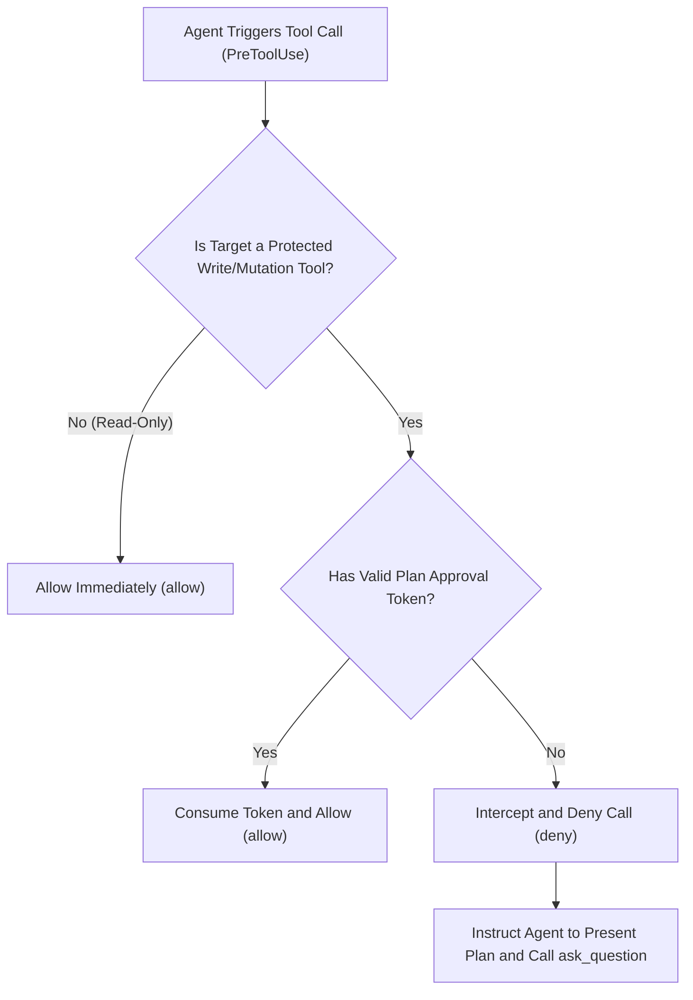

<p align="center">
  
</p>

<h1 align="center">Antigravity Plan Guard</h1>

<p align="center">
  <b>Google Antigravity 2.0 Plan-First Zero-Trust Gatekeeper Plugin</b><br>
  Intercepts unauthorized file writes and side-effect commands, compelling the primary agent to conduct plan reviews via <code>ask_question</code>.
</p>

<p align="center">
  <a href="https://github.com/ToruOlenyeva/antigravity-plan-guard/blob/main/LICENSE"></a>
  <a href="https://nodejs.org/"></a>
  <a href="https://github.com/ToruOlenyeva/antigravity-plan-guard/stargazers"></a>
  <a href="README.md"></a>
</p>

---

## 📖 Table of Contents

- [Core Features](#-core-features)
- [Installation and Deployment](#-installation-and-deployment)
- [Usage Scenarios](#-usage-scenarios)
- [Interception Workflow](#-interception-workflow)
- [Whitelisting and Rules](#-whitelisting-and-rules)
- [Architecture and Advanced Docs](#-architecture-and-advanced-docs)
- [License](#-license)

---

## 🌟 Core Features

- <b>Zero-Trust Defense</b>: Rigorous monitoring at the `PreToolUse` lifecycle stage. All file modifications and side-effect terminal commands are intercepted prior to explicit user confirmation.
- <b>Plan-First Prompt Injection</b>: Dynamically analyzes incomplete tasks via `PreInvocation` hooks and injects alignment directives into the agent context, preventing hasty coding.
- <b>Interactive Confirmation Loop</b>: Compels the agent to present proposals and trigger interactive modal dialogs via `ask_question`. The gate automatically clears once confirmed.
- <b>Subagent Passthrough</b>: Transparently identifies read-only subagents and controlled sessions to prevent redundant dialog friction while preserving defense integrity.
- <b>Zero External Dependencies</b>: Built entirely on vanilla Node.js with zero npm dependencies, ultra-fast cold start, and sub-millisecond evaluation latency.

---

## 🚀 Installation and Deployment

### 1. Global Plugin Installation (Recommended)

Clone the repository into your Antigravity global plugin directory:

```bash
cd ~/.gemini/config/plugins
git clone https://github.com/ToruOlenyeva/antigravity-plan-guard.git plan-guard
```

### 2. Workspace Installation

Ideal for repository-scoped security policies or isolated workspaces:

```bash
cd /path/to/your/workspace
git clone https://github.com/ToruOlenyeva/antigravity-plan-guard.git .gemini/plugins/plan-guard
```

### 3. Activation

Copy the sample hook configuration:

```bash
cd plan-guard
cp hooks.example.json hooks.json
```

If utilizing a plugin manager such as `plugin-switcher`, toggle it directly in the UI.

---

## 💡 Usage Scenarios

### Scenario 1: Read-Only Research & Inquiries

When the agent uses `read_file`, searches code, or performs web lookups, Plan Guard permits immediate execution without friction.

### Scenario 2: Code Refactoring & Disk Writes

When the agent attempts `write_file`, `edit_file`, or mutative bash executions:
1. The gatekeeper blocks the attempt and provides structured guidance.
2. The agent explains the proposed diff in the chat body and triggers an `ask_question` confirmation dialog.
3. Upon approval, the security state machine unlocks the operation and permits file modification.

### Scenario 3: Autonomous Subagent Orchestration

When the primary agent delegates tasks to read-only subagents, passthrough is granted automatically. For mutating subtasks, the primary agent secures approval beforehand.

---

## 🔄 Interception Workflow



---

## ⚙️ Whitelisting and Rules

Configured inside `hooks/pre-tool-use-guard.js`:

- <b>Protected Tools</b>: `write_file`, `edit_file`, `replace_file_content`, mutating `run_command`
- <b>Approval Token</b>: Issued upon positive user confirmation through `ask_question`.

For custom rule definitions, refer to [Architecture Specification](docs/ARCHITECTURE.en.md).

---

## 📚 Architecture and Advanced Docs

- [System Architecture Specification (English)](docs/ARCHITECTURE.en.md)
- [系统详细架构文档 (中文)](docs/ARCHITECTURE.md)
- [Chinese Documentation (README.md)](README.md)

---

## 📄 License

Distributed under the [MIT License](LICENSE).
