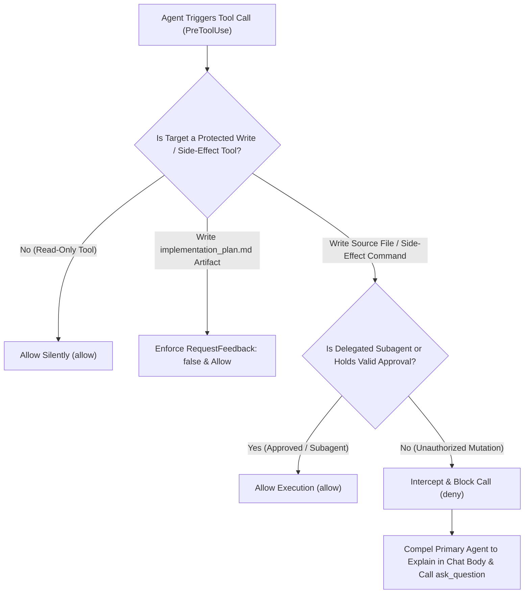

[English](README.en.md) | [简体中文](README.md)

<div align="center">
  
  <h1>Antigravity Plan Guard</h1>
  <p>
    <b>Plan-First Zero-Trust Gatekeeper Plugin for Google Antigravity 2.0</b><br>
    Intercepts unauthorized file writes and side-effect commands, compelling the primary agent to conduct plan reviews via <code>ask_question</code>.
  </p>
  <p>
    <a href="https://antigravity.google/"></a>
    <a href="https://nodejs.org/"></a>
    <a href="docs/ARCHITECTURE.en.md"></a>
    <a href="LICENSE"></a>
    <a href="https://github.com/ToruOlenyeva/antigravity-plan-guard/stargazers"></a>
  </p>
</div>

> <b>Stop unauthorized code mutations and duplicate confirmation prompts</b>: Purpose-built for <b>Google Antigravity 2.0</b> (the parallel multi-agent desktop client). Solves the critical issue where LLMs overwrite source files without approval or trigger duplicate native `Proceed` and `ask_question` prompts when writing `implementation_plan.md` artifacts, enforcing a deterministic zero-trust state machine at the `PreToolUse` / `PostToolUse` hook layer.

---

## ✨ Key Features

- <b>Zero-Trust Write Interception</b>: Strictly monitors the `PreToolUse` lifecycle. All source code writes, file edits, and side-effect terminal commands are blocked prior to explicit user approval, returning structured remediation directives to the model.
- <b>Same-Turn Explanation Enforcement</b>: Compels the primary agent to output a complete root-cause and architectural explanation in the chat body within the exact same turn as calling the `ask_question` modal.
- <b>Native `Proceed` Duplicate Suppression</b>: Automatically intercepts `ArtifactMetadata.RequestFeedback: true` when writing plan artifacts, eliminating redundant native `Proceed` review bars alongside `ask_question` modals.
- <b>Subagent Passthrough</b>: Automatically identifies delegated subagents via `transcript.jsonl` lineage inspection, granting friction-free execution to child agents once the primary agent secures approval.
- <b>Zero External Dependencies</b>: Single-file vanilla Node.js implementation (`guard.cjs`) with zero npm dependencies and sub-millisecond evaluation latency.

---

## 🔄 Core Workflow



---

## 🚀 Quick Installation

Built with native Node.js and <b>Zero Dependencies</b>. Clone and run immediately without executing <code>npm install</code>.

### 1. Clone into Antigravity Plugins Directory

<b>macOS / Linux</b>:
```bash
git clone https://github.com/ToruOlenyeva/antigravity-plan-guard.git ~/.gemini/config/plugins/plan-guard
cp ~/.gemini/config/plugins/plan-guard/hooks.example.json ~/.gemini/config/plugins/plan-guard/hooks.json
```

<b>Windows (PowerShell)</b>:
```powershell
git clone https://github.com/ToruOlenyeva/antigravity-plan-guard.git "$env:USERPROFILE\.gemini\config\plugins\plan-guard"
Copy-Item "$env:USERPROFILE\.gemini\config\plugins\plan-guard\hooks.example.json" "$env:USERPROFILE\.gemini\config\plugins\plan-guard\hooks.json"
```

<b>Windows (CMD)</b>:
```cmd
git clone https://github.com/ToruOlenyeva/antigravity-plan-guard.git %USERPROFILE%\.gemini\config\plugins\plan-guard
copy %USERPROFILE%\.gemini\config\plugins\plan-guard\hooks.example.json %USERPROFILE%\.gemini\config\plugins\plan-guard\hooks.json
```

### 2. Enable and Launch

After cloning and generating `hooks.json` (replace `<ABSOLUTE_PATH_TO_PLUGINS>` in `hooks.json` with your actual plugins directory path), restart Google Antigravity or toggle the plugin directly in `plugin-switcher`.

---

## 📖 Usage Guide

### 1. Read-Only Research & Code Inspection
When the agent executes `read_file`, searches codebases, or runs read-only terminal verification commands (such as `git status`, `tsc --noEmit`, or `cargo check`), Plan Guard allows execution silently with zero friction.

### 2. Code Refactoring & Multi-Option Plan Approval
When the agent intends to modify source files or execute mutating commands:
- The primary agent explains the root cause and design rationale in the chat response while rendering an `ask_question` confirmation modal.
- Select the recommended confirmation button for single-plan execution, or pick between `Option A` and `Option B` when multiple architectural trade-offs are presented.
- Submitting custom Write-In feedback automatically resets the approval state, ensuring the agent revises its plan and re-confirms before touching disk.

### 3. Autonomous Subagent Orchestration
Once you approve a plan on the primary agent and it delegates batch implementation via `invoke_subagent`, child subagents automatically bypass interactive prompts to execute concurrent file writes and test suites at full speed.

---

## 📚 Documentation Matrix

| Module | Description & Technical Details | Link |
| :--- | :--- | :--- |
| <b>System Architecture</b> | Three-phase gate model, state machine transitions, native `Proceed` button mechanics, and JSON contracts | [View Architecture](docs/ARCHITECTURE.en.md) |
| <b>Example Hook Configuration</b> | Standard `PreToolUse` and `PostToolUse` lifecycle hook registration template | [View Example Config](hooks.example.json) |

---

## 🤝 Contributors & Credits

- <b>[Toru Olenyeva](https://github.com/ToruOlenyeva)</b>
- <b>[Google Antigravity](https://antigravity.google/)</b>

---

## 📄 License

This project is licensed under the [<b>MIT License</b>](LICENSE).
