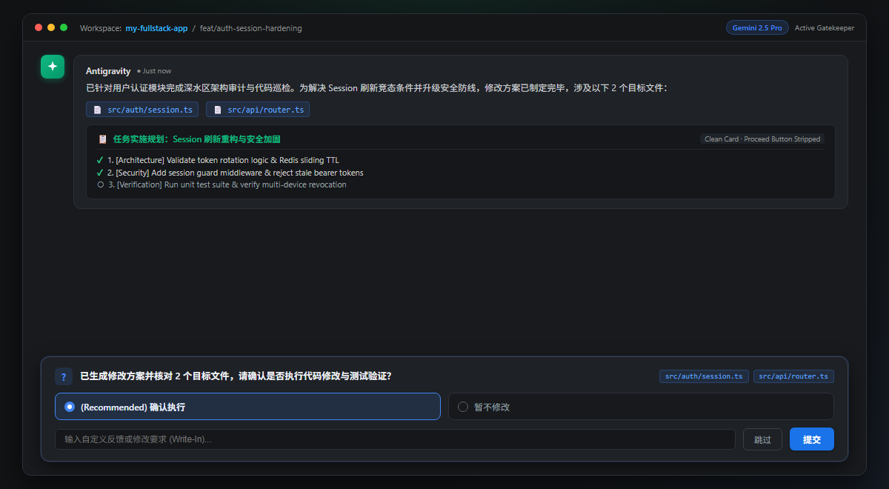
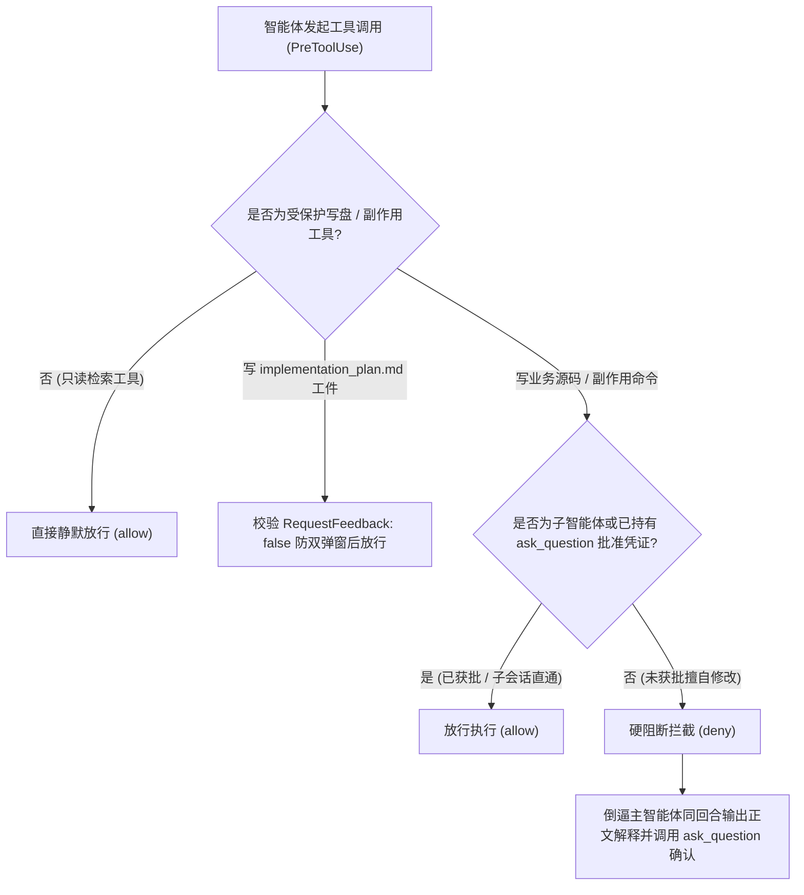

[English](README.en.md) | [简体中文](README.md)

<div align="center">
  
  <h1>Antigravity Plan Guard</h1>
  <p>
    <b>Google Antigravity 2.0 方案先行零信任门禁系统</b><br>
    拦截擅自写盘与副作用命令，倒逼主智能体通过 <code>ask_question</code> 进行方案预审与卡点对齐。
  </p>
  <p>
    <a href="https://antigravity.google/"></a>
    <a href="https://nodejs.org/"></a>
    <a href="docs/ARCHITECTURE.md"></a>
    <a href="LICENSE"></a>
    <a href="https://github.com/ToruOlenyeva/antigravity-plan-guard/stargazers"></a>
  </p>
</div>

> <b>终结 AI 擅自改代码与无效弹窗干扰</b>：专为 <b>Google Antigravity 2.0</b>（并行多智能体桌面客户端）打造。针对大模型在复杂任务中未经确认直接覆写源码、或在输出 `implementation_plan.md` 工件时重复弹出原生 `Proceed` 与 `ask_question` 双重确认框的痛点，在 `PreToolUse` / `PostToolUse` 底层构建零信任确定性状态机门禁。

<div align="center">
  
</div>

---

## ✨ 核心特性

- <b>零信任写盘硬拦截</b>：严格监控 `PreToolUse` 生命周期，所有代码写盘、文件覆盖及具有副作用的终端命令在未获用户确认前均被硬阻断，并向模型回传结构化引导指令。
- <b>同回合正文解释强约束</b>：强制要求主智能体在调用 `ask_question` 弹窗的同一回合内先在聊天正文输出完整原因分析，弹窗内仅展示纯修改方案与可点击文件芯片。
- <b>无按钮纯净 `Implementation Plan` 大卡片守护</b>：针对宿主 `language_server.exe` 的 Go `proto3` 零值忽略特性，在 `PreToolUse`、`PostToolUse` 及异步守护层自动将磁盘 `.metadata.json` 中的 `requestFeedback` 物理覆写为 `false`，彻底剥离卡片右下角冗余的蓝色「继续 `Ctrl+↵`」（`Proceed`）按钮，仅保留干净可点击的方案大卡片。
- <b>子智能体免打扰直通</b>：通过会话 `transcript.jsonl` 溯源自动识别由主智能体委派的子智能体（Subagent），主智能体单点确认后子智能体直接高速并发落盘，零二次弹窗阻塞。
- <b>中英文用户语言自动识别</b>：根据对话上下文（`transcript.jsonl` 最新用户输入语言或系统区域）智能识别 `zh` / `en`，自动切换拦截提示词与确认按钮文案（中文用户展示「`确认执行 / 暂不修改`」，英文用户展示「`Confirm & Execute / Cancel`」）。
- <b>零外部依赖轻量设计</b>：单文件纯原生 Node.js 实现（`guard.cjs`），零第三方 npm 包依赖，亚毫秒级状态机裁决。

---

## 🔄 核心工作流原理



---

## 🚀 快速安装

本项目采用纯原生 Node.js 构建，<b>零外部依赖（Zero Dependencies）</b>，克隆即可运行，无需执行 <code>npm install</code>。

### 1. 克隆插件至 Antigravity 插件目录

<b>macOS / Linux</b>:
```bash
git clone https://github.com/ToruOlenyeva/antigravity-plan-guard.git ~/.gemini/config/plugins/plan-guard
```

<b>Windows (PowerShell)</b>:
```powershell
git clone https://github.com/ToruOlenyeva/antigravity-plan-guard.git "$env:USERPROFILE\.gemini\config\plugins\plan-guard"
```

<b>Windows (CMD)</b>:
```cmd
git clone https://github.com/ToruOlenyeva/antigravity-plan-guard.git %USERPROFILE%\.gemini\config\plugins\plan-guard
```

### 2. 生效与启动

克隆完成后，重启 Google Antigravity 或通过 `plugin-switcher` 面板一键启用即可生效。

---

## 📖 使用方法指南

### 1. 日常只读咨询与代码检索
当智能体执行 `read_file`、搜索代码、查看状态或执行只读终端检查命令（如 `git status`、`tsc --noEmit`、`cargo check`）时，门禁全程静默放行，零弹窗打扰。

### 2. 代码修改与多方案决策确认
当智能体准备修改业务代码或执行写入命令时：
- 主智能体会在聊天正文中详细说明问题根因与修改逻辑，同时弹出 `ask_question` 确认框。
- 单方案场景直接点击 `确认执行` 即可开闸放行；多方案对比场景可直接点选 `采用方案 A` / `采用方案 B`。
- 若你在弹窗底部输入框（Write-In）填写了补充意见，门禁会自动重置为待定状态，要求智能体根据你的补充意见调整方案后再次确认。

### 3. 多智能体并发协作（Subagent Passthrough）
当主智能体通过 `ask_question` 获得你的确认并调用 `invoke_subagent` 派发后台子智能体施工时，子智能体拥有免弹窗直通权限，可在后台直接高速完成多文件并发读写与测试验证。

---

## 📚 官方技术文档中心

| 模块名称 | 说明与技术细节 | 链接 |
| :--- | :--- | :--- |
| <b>系统架构设计</b> | 三阶段门禁裁决模型、状态机转换、原生 `Proceed` 按钮触发机制与接口规范 | [查看架构文档](docs/ARCHITECTURE.md) |
| <b>示例钩子配置</b> | 标准 `PreToolUse` 与 `PostToolUse` 生命周期钩子挂载配置模板 | [查看示例配置](hooks.example.json) |

---

## 🤝 贡献与共创团队

- <b>[Toru Olenyeva](https://github.com/ToruOlenyeva)</b>
- <b>[Google Antigravity](https://antigravity.google/)</b>

---

## 📄 开源协议

本项目基于 [<b>MIT License</b>](LICENSE) 开源。
