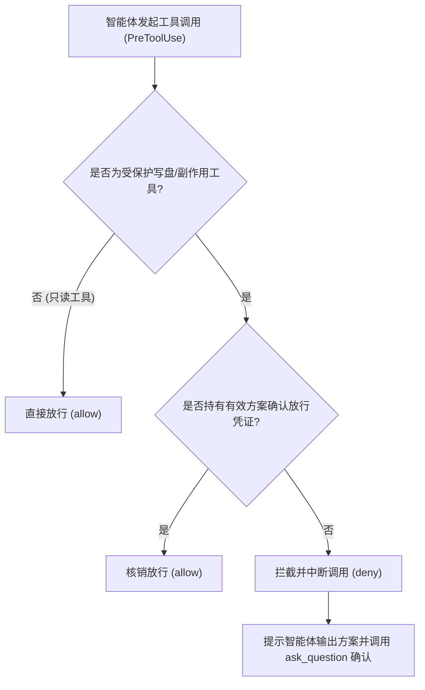

<p align="center">
  
</p>

<h1 align="center">Antigravity Plan Guard</h1>

<p align="center">
  <b>Google Antigravity 2.0 方案先行零信任门禁系统</b><br>
  拦截擅自写盘与副作用命令，倒逼主智能体通过 <code>ask_question</code> 进行方案预审与卡点对齐。
</p>

<p align="center">
  <a href="https://github.com/ToruOlenyeva/antigravity-plan-guard/blob/main/LICENSE"></a>
  <a href="https://nodejs.org/"></a>
  <a href="https://github.com/ToruOlenyeva/antigravity-plan-guard/stargazers"></a>
  <a href="README.en.md"></a>
</p>

---

## 📖 目录

- [核心特性](#-核心特性)
- [三端安装与部署指南](#-三端安装与部署指南)
- [分场景使用指南](#-分场景使用指南)
- [拦截工作流原理](#-拦截工作流原理)
- [白名单与放行规则配置](#-白名单与放行规则配置)
- [深入架构与进阶文档](#-深入架构与进阶文档)
- [开源许可证](#-开源许可证)

---

## 🌟 核心特性

- <b>零信任防御拦截</b>：严格监控 `PreToolUse` 生命周期。所有写盘、覆盖及副作用终端命令在未经确认前均被硬阻断并回掷重试提示。
- <b>方案先行卡点注入</b>：通过 `PreInvocation` 钩子解析当前任务进度，若存在未完成任务则强制向智能体上下文注入方案卡点提醒，阻止冒进编码。
- <b>交互式确认闭环</b>：智能体必须调用 `ask_question` 渲染交互弹窗并获得确认；门禁系统在识别到确认状态后自动开闸放行。
- <b>子智能体免打扰直通</b>：自动识别只读子会话与受控子智能体，在保障隔离的前提下豁免冗余交互，兼顾极致安全与高效吞吐。
- <b>零外部依赖轻量设计</b>：纯原生 Node.js 实现，无第三方包依赖，极速冷启动，亚毫秒级拦截判定。

---

## 🚀 三端安装与部署指南

### 1. 全局插件安装（推荐）

将本仓库克隆至 Antigravity 全局插件目录：

```bash
cd ~/.gemini/config/plugins
git clone https://github.com/ToruOlenyeva/antigravity-plan-guard.git plan-guard
```

### 2. 局部工作区安装

适用于特定工程或安全敏感代码库的独立门禁控制：

```bash
cd /path/to/your/workspace
git clone https://github.com/ToruOlenyeva/antigravity-plan-guard.git .gemini/plugins/plan-guard
```

### 3. 配置激活

从示例配置文件复制并生成运行配置：

```bash
cd plan-guard
cp hooks.example.json hooks.json
```

若使用的是 Antigravity 插件管理器（如 `plugin-switcher`），亦可通过界面直接勾选启用。

---

## 💡 分场景使用指南

### 场景一：日常只读咨询与调研

智能体执行 `read_file`、搜索代码库或调用 `search_web` 时，门禁全程静默放行，无感知、零阻碍。

### 场景二：代码重构与写盘修改

当智能体试图调用 `write_file`、`edit_file` 或执行写操作命令时：
1. 门禁系统阻断该调用并返回结构化指导提示。
2. 智能体根据反馈在对话正文阐明方案，同时调用 `ask_question` 弹出双选弹窗。
3. 用户点击确认后，门禁状态机转为已核准，后续写盘调用顺利放行。

### 场景三：多智能体并发协作

主智能体派发只读子智能体进行大规模调研时，子智能体自动直通；若派发写入任务，由主智能体先行完成方案锁定，子智能体聚焦高速执行。

---

## 🔄 拦截工作流原理



---

## ⚙️ 白名单与放行规则配置

插件通过 `hooks/pre-tool-use-guard.js` 维护工具判定规则：

- <b>保护工具列表</b>：`write_file`, `edit_file`, `replace_file_content`, `run_command`（写模式）
- <b>放行凭证机制</b>：用户在 `ask_question` 选择确认项后激活单次或批次放行会话。

如需调整特定安全命令白名单，可查阅 [深入架构文档](docs/ARCHITECTURE.md)。

---

## 📚 深入架构与进阶文档

- [系统详细架构文档 (中文)](docs/ARCHITECTURE.md)
- [System Architecture Specification (English)](docs/ARCHITECTURE.en.md)
- [双语英文说明 (README.en.md)](README.en.md)

---

## 📄 开源许可证

本项目基于 [MIT 许可证](LICENSE) 开源。
