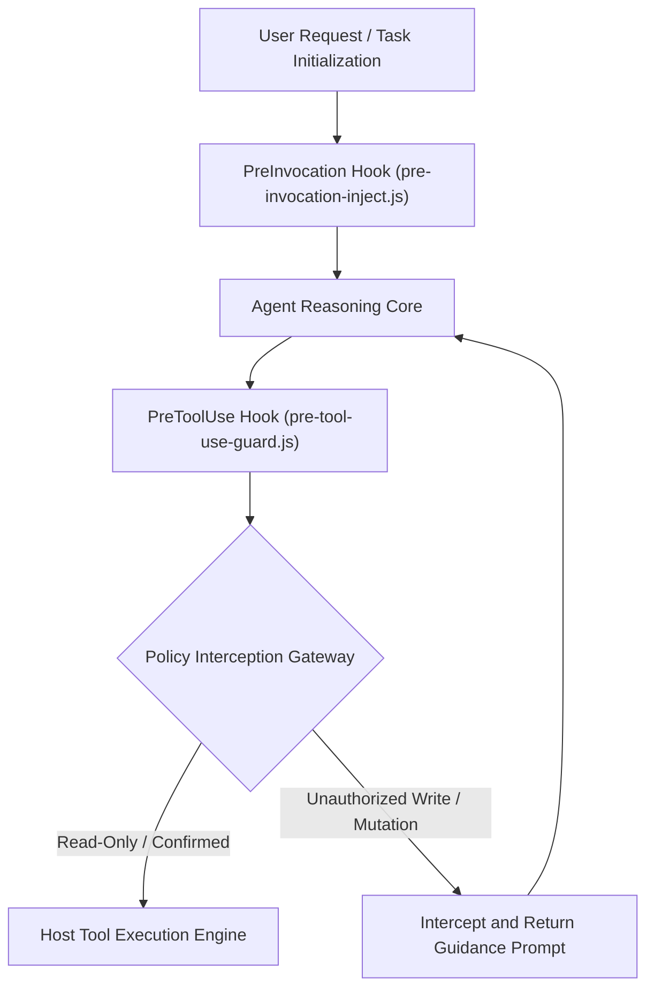

[English](ARCHITECTURE.en.md) | [简体中文](ARCHITECTURE.md)

# Antigravity Plan Guard Architecture Specification

This document details the underlying architecture, lifecycle hook mechanisms, and state evaluation model of the Google Antigravity 2.0 Plan-First Zero-Trust Gatekeeper System (`plan-guard`).

---

## 1. Overall System Architecture

Plan Guard integrates into the Antigravity plugin lifecycle via non-intrusive hooks, establishing a security barrier between agent deliberation and tool invocation.



---

## 2. Core Architectural Principles

### 2.1 Zero-Trust Baseline

All tool calls involving file modifications, workspace mutations, or system side effects are untrusted by default until explicit approval or plan confirmation tokens are verified.

### 2.2 Plan-First Enforcement

Code modifications must not bypass plan alignment. When pending checklist tasks remain active, the gate dynamically injects alignment directives into the reasoning context to prevent unguided edits.

### 2.3 Subagent Transparency

Read-only research subagents or sub-sessions explicitly authorized by the primary orchestrator are granted passthrough via call stack metadata, preventing redundant dialog popups.

---

## 3. Lifecycle Hook Contracts

### 3.1 PreInvocation: Plan Status Analysis and Guidance Injection

- <b>Execution Point</b>: Before each turn of agent model inference.
- <b>Responsibility</b>: Evaluates active task progression; injects guidance directives into dynamic context when unresolved items exist.

### 3.2 PreToolUse: Pre-Execution Guard Interception

- <b>Execution Point</b>: After tool invocation is generated by the model but prior to host execution.
- <b>Responsibility</b>: Evaluates target tool name and payload against policy rules and current authorization tokens. Returns a denial decision if preconditions are unmet.
- <b>Artifact Duplicate-Prompt Prevention (`RequestFeedback: false`)</b>: Simple tasks bypass `implementation_plan.md` generation; complex tasks allow writing `implementation_plan.md` and brain artifacts while physically enforcing `ArtifactMetadata.RequestFeedback: false` to prevent duplicate native `Proceed` confirmation prompts at the end of the turn.

### 3.3 Native Proceed Button Trigger Mechanism and Duplicate-Prompt Boundary

Based on empirical verification against the Antigravity 2.0 host event stream (`transcript.jsonl`) and tool schemas, the native blue `Proceed` (`Ctrl+Enter`) button operates under the following four rules:

1. <b>Artifact-Bound Control (No Standalone Tool)</b>:
   - Antigravity 2.0 does not expose a standalone `Proceed` button tool. The button is a UI attachment bound exclusively to `write_file` / `edit_file` calls targeting the `.gemini/antigravity/brain/<conversation-id>/` artifact directory (specifically `implementation_plan.md`) with `ArtifactMetadata`. Without creating or updating an artifact `.md` file, the frontend has no carrier to mount the `Proceed` button.
2. <b>Non-Blocking Write and End-of-Turn (Yield Turn) Deferred Mounting</b>:
   - Unlike `ask_question`, which is a blocking tool call that immediately suspends the turn to render a modal, `write_file(implementation_plan.md)` is a non-blocking call that returns `"Created file."` within milliseconds while keeping the model inside its active generation turn.
   - The host UI <b>only mounts the `Implementation Plan` review card and `Proceed` button at the exact moment the model finishes its turn (stops calling tools and yields control back to the user)</b>.
   - If the model writes `implementation_plan.md` and calls `ask_question` in the same turn, the `ask_question` modal blocks first, and the `Proceed` button is deferred until the model eventually ends a subsequent turn (`0 tool calls`), resulting in a redundant second prompt.
3. <b>Host `Artifact Review Mode` Precedence Over `RequestFeedback`</b>:
   - <b>`asks-for-review`</b>: The frontend overrides `RequestFeedback: false` and forcibly renders the `Proceed` button at the end of the turn whenever `implementation_plan.md` (`UserFacing: true`) is written.
   - <b>`agent-decides` / `always-proceed`</b>: The frontend honors `ArtifactMetadata.RequestFeedback`. When `guard.cjs` Phase 3 enforces `RequestFeedback: false`, the duplicate `Proceed` bar is suppressed and confirmation is unified under `ask_question`.
4. <b>Underlying `transcript.jsonl` Approval Payload</b>:
   - Clicking `Proceed` appends a `source: "USER_EXPLICIT", type: "USER_INPUT"` entry to `transcript.jsonl` with the fixed payload:
     ```text
     Comments on artifact URI: file:///.../implementation_plan.md

     The user has approved this document.
     ```
   - `isUserAuthorized()` in `guard.cjs` recognizes the `approved this document` signature to transition the state machine to approved.

---

## 4. Interface Protocols

### 4.1 Verdict Response Contract

The gate hook communicates verdicts to the host runtime via stdout using JSON:

```json
{
  "verdict": "allow",
  "reason": "Read-only inspection permitted"
}
```

Denial response contract:

```json
{
  "verdict": "deny",
  "reason": "Modification intercepted: please present the diff and call ask_question first."
}
```

---

## 5. Directory Structure

```
plan-guard/
├── .gitignore
├── LICENSE
├── README.md
├── README.en.md
├── plugin.json
├── hooks.example.json
├── assets/
│   └── logo.svg
├── docs/
│   ├── ARCHITECTURE.md
│   └── ARCHITECTURE.en.md
└── guard.cjs
```
