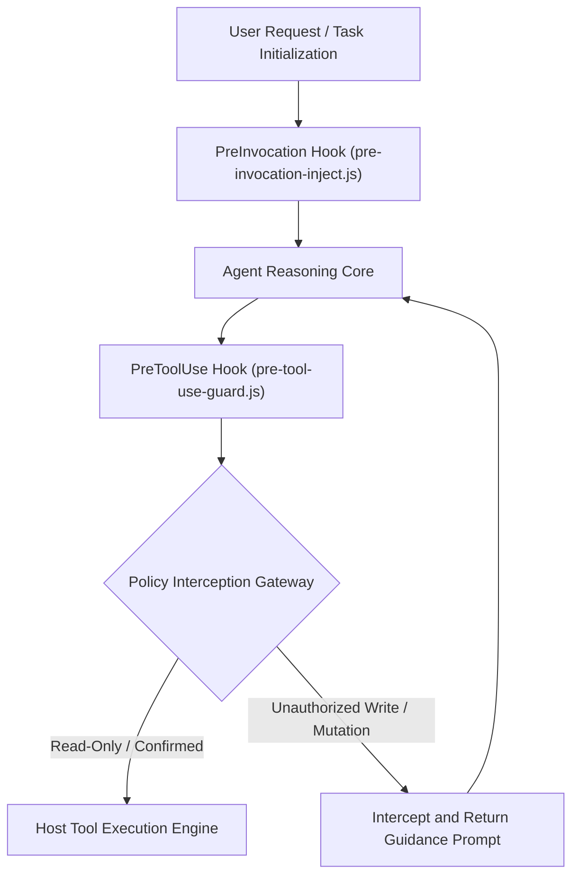

[English](ARCHITECTURE.en.md) | [简体中文](ARCHITECTURE.md)

# Antigravity Plan Guard Architecture Specification

This document details the underlying architecture, lifecycle hook mechanisms, and state evaluation model of the Google Antigravity 2.0 Plan-First Zero-Trust Gatekeeper System (`plan-guard`).

---

## 1. Overall System Architecture

Plan Guard integrates into the Antigravity plugin lifecycle via non-intrusive hooks, establishing a security barrier between agent deliberation and tool invocation.



---

## 2. Core Architectural Principles

### 2.1 Zero-Trust Baseline

All tool calls involving file modifications, workspace mutations, or system side effects are untrusted by default until explicit approval or plan confirmation tokens are verified.

### 2.2 Plan-First Enforcement

Code modifications must not bypass plan alignment. When pending checklist tasks remain active, the gate dynamically injects alignment directives into the reasoning context to prevent unguided edits.

### 2.3 Subagent Transparency

Read-only research subagents or sub-sessions explicitly authorized by the primary orchestrator are granted passthrough via call stack metadata, preventing redundant dialog popups.

---

## 3. Lifecycle Hook Contracts

### 3.1 PreInvocation: Plan Status Analysis and Guidance Injection

- <b>Execution Point</b>: Before each turn of agent model inference.
- <b>Responsibility</b>: Evaluates active task progression; injects guidance directives into dynamic context when unresolved items exist.

### 3.2 PreToolUse: Pre-Execution Guard Interception

- <b>Execution Point</b>: After tool invocation is generated by the model but prior to host execution.
- <b>Responsibility</b>: Evaluates target tool name and payload against policy rules and current authorization tokens. Returns a denial decision if preconditions are unmet.
- <b>Complexity Tiering and Card Presentation Strategy</b>: Simple tasks (`<= 3` files) bypass `implementation_plan.md` generation (no large card, using inline chat explanation + `ask_question` confirmation); complex tasks (`> 3` files or multi-option architectural designs) write `implementation_plan.md` in the brain directory, combining the `ask_question` option modal with the large clickable `Implementation Plan` card mounted at the end of the turn.

### 3.3 Frontend Lifecycle of the Implementation Plan Card and Native Proceed Button

Based on empirical verification against the Antigravity 2.0 host event stream (`transcript.jsonl`) and frontend rendering states, the large `Implementation Plan` card and native blue `Proceed` (`Ctrl+Enter`) button operate under the following four lifecycle rules:

1. <b>Artifact-Bound Control (No Standalone Tool)</b>:
   - Antigravity 2.0 does not expose a standalone `Proceed` button tool. Both the large card and the button are UI attachments bound exclusively to `write_file` / `edit_file` calls targeting the `.gemini/antigravity/brain/<conversation-id>/` artifact directory (specifically `implementation_plan.md`) with `ArtifactMetadata`. Without creating or updating an artifact `.md` file, the frontend has no carrier to mount the card.
2. <b>Non-Blocking Write and End-of-Turn (Yield Turn) Deferred Mounting</b>:
   - Unlike `ask_question`, which is a mid-turn blocking tool call that immediately suspends the turn to render an option modal, `write_file(implementation_plan.md)` is a non-blocking call that returns `"Created file."` within milliseconds while keeping the model inside its active generation turn.
   - The host UI <b>does not mount the large card at the moment `write_file` is called</b>; instead, it queues the artifact update and <b>mounts the clickable `Implementation Plan` card at the bottom of the assistant message only when the model finishes its turn (stops calling tools and yields control)</b>.
   - Consequently, when `write_file(implementation_plan.md)` and `ask_question` are called in the same turn, the large card is not yet mounted while `ask_question` awaits user input (users can click the `[implementation_plan.md](file:///...)` chip in the chat body to open the split-pane preview immediately), and the large card mounts as soon as the turn finishes.
3. <b>Active Bottom-of-Chat Visibility Rule for the Blue `Proceed` Button (Independent of `RequestFeedback`)</b>:
   - Empirical testing confirms that regardless of whether `ArtifactMetadata.RequestFeedback` is set to `true` or `false`, whenever an `implementation_plan.md` (`UserFacing: true`) is written, the visibility of the blue `Proceed` (`Ctrl+Enter`) button on the bottom-right corner of the card is governed solely by <b>whether that assistant message is currently the very last (active) message at the bottom of the chat stream</b>:
     - <b>Active State (Button Visible)</b>: While the assistant message containing the `Implementation Plan` card sits at the <b>very bottom of the chat window as the latest message</b> (for instance, during the 1–3 minute window where the main agent spawns a background subagent `1 subagent running` and pauses its own turn waiting for completion), the blue `Proceed` (`Ctrl+Enter`) button is displayed on the card;
     - <b>Historical State (Button Automatically Hidden, Leaving a Clean Card)</b>: As soon as the subagent completes and the main agent outputs the final summary below it, or as soon as a new turn begins after a multi-option selection, that message is no longer at the bottom of the chat stream. The frontend <b>automatically hides and removes the blue `Proceed` button</b>, leaving the clean, large, clickable `Implementation Plan` card in the conversation history.
4. <b>Underlying `transcript.jsonl` Approval Payload</b>:
   - If the user clicks the `Proceed` button directly, the host appends a `source: "USER_EXPLICIT", type: "USER_INPUT"` entry to `transcript.jsonl` with the fixed payload:
     ```text
     Comments on artifact URI: file:///.../implementation_plan.md

     The user has approved this document.
     ```
   - `isUserAuthorized()` in `guard.cjs` recognizes the `approved this document` signature to transition the state machine to approved.

---

## 4. Interface Protocols

### 4.1 Verdict Response Contract

The gate hook communicates verdicts to the host runtime via stdout using JSON:

```json
{
  "verdict": "allow",
  "reason": "Read-only inspection permitted"
}
```

Denial response contract:

```json
{
  "verdict": "deny",
  "reason": "Modification intercepted: please present the diff and call ask_question first."
}
```

---

## 5. Directory Structure

```
plan-guard/
├── .gitignore
├── LICENSE
├── README.md
├── README.en.md
├── plugin.json
├── hooks.example.json
├── assets/
│   └── logo.svg
├── docs/
│   ├── ARCHITECTURE.md
│   └── ARCHITECTURE.en.md
└── guard.cjs
```
