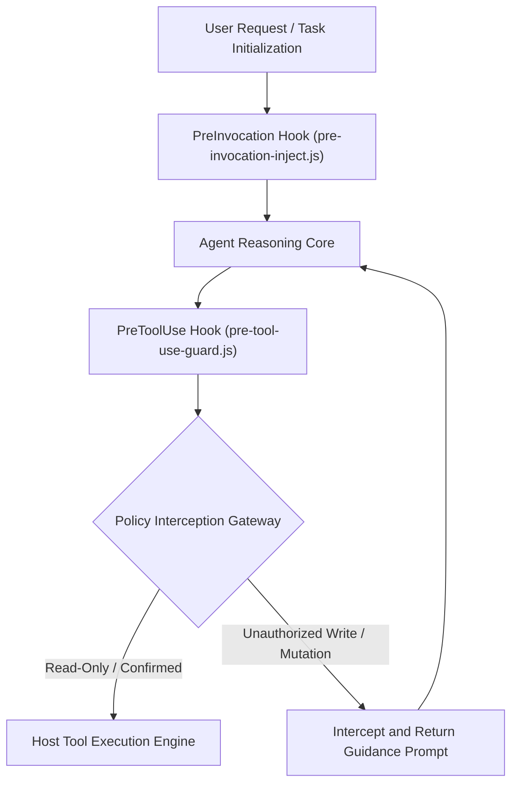

# Antigravity Plan Guard Architecture Specification

This document details the underlying architecture, lifecycle hook mechanisms, and state evaluation model of the Google Antigravity 2.0 Plan-First Zero-Trust Gatekeeper System (`plan-guard`).

---

## 1. Overall System Architecture

Plan Guard integrates into the Antigravity plugin lifecycle via non-intrusive hooks, establishing a security barrier between agent deliberation and tool invocation.



---

## 2. Core Architectural Principles

### 2.1 Zero-Trust Baseline

All tool calls involving file modifications, workspace mutations, or system side effects are untrusted by default until explicit approval or plan confirmation tokens are verified.

### 2.2 Plan-First Enforcement

Code modifications must not bypass plan alignment. When pending checklist tasks remain active, the gate dynamically injects alignment directives into the reasoning context to prevent unguided edits.

### 2.3 Subagent Transparency

Read-only research subagents or sub-sessions explicitly authorized by the primary orchestrator are granted passthrough via call stack metadata, preventing redundant dialog popups.

---

## 3. Lifecycle Hook Contracts

### 3.1 PreInvocation: Plan Status Analysis and Guidance Injection

- <b>Execution Point</b>: Before each turn of agent model inference.
- <b>Responsibility</b>: Evaluates active task progression; injects guidance directives into dynamic context when unresolved items exist.

### 3.2 PreToolUse: Pre-Execution Guard Interception

- <b>Execution Point</b>: After tool invocation is generated by the model but prior to host execution.
- <b>Responsibility</b>: Evaluates target tool name and payload against policy rules and current authorization tokens. Returns a denial decision if preconditions are unmet.
- <b>Artifact Duplicate-Prompt Prevention (`RequestFeedback: false`)</b>: Simple tasks bypass `implementation_plan.md` generation; complex tasks allow writing `implementation_plan.md` and brain artifacts while physically enforcing `ArtifactMetadata.RequestFeedback: false` to prevent duplicate native `Proceed` confirmation prompts at the end of the turn.

---

## 4. Interface Protocols

### 4.1 Verdict Response Contract

The gate hook communicates verdicts to the host runtime via stdout using JSON:

```json
{
  "verdict": "allow",
  "reason": "Read-only inspection permitted"
}
```

Denial response contract:

```json
{
  "verdict": "deny",
  "reason": "Modification intercepted: please present the diff and call ask_question first."
}
```

---

## 5. Directory Structure

```
plan-guard/
├── .gitignore
├── LICENSE
├── README.md
├── README.en.md
├── plugin.json
├── hooks.example.json
├── assets/
│   └── logo.svg
├── docs/
│   ├── ARCHITECTURE.md
│   └── ARCHITECTURE.en.md
└── guard.cjs
```
