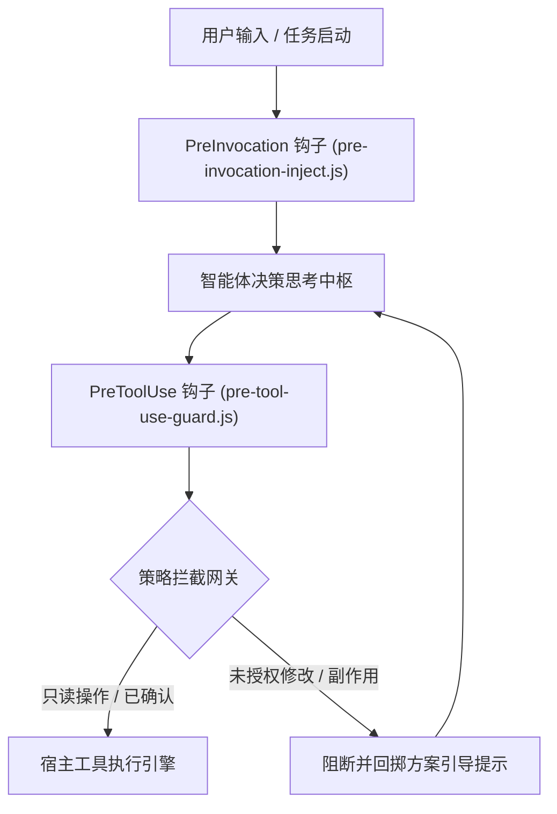

[English](ARCHITECTURE.en.md) | [简体中文](ARCHITECTURE.md)

# Antigravity Plan Guard 架构设计规范

本文档详述 Google Antigravity 2.0 方案先行零信任门禁系统（`plan-guard`）的底层架构、生命周期钩子执行机制以及状态机演进模型。

---

## 1. 总体架构拓扑

Plan Guard 基于 Antigravity 插件系统的钩子架构进行轻量级无侵入切入，在智能体思考周期与工具调用周期之间构建安全护城河。



---

## 2. 核心设计原则

### 2.1 零信任原则（Zero-Trust Baseline）

任何涉及文件持久化、工作区内容变更或系统环境产生副作用的工具调用，均默认处于非受信任状态，直至捕获到明确的用户授权或方案确认标记。

### 2.2 方案先行保障（Plan-First Enforcement）

代码变更不得跳过方案对齐阶段。门禁系统在任务存在未完成清单项（如未闭环的 `todo` / 需求）时，在推理前置切面动态注入对齐指令，防止智能体在未形成完整设计前直接改写代码。

### 2.3 子智能体非受阻（Subagent Transparency）

只读调研类子智能体（如 `research`）或已被主流程显式授权的分支重构子会话，依据调用栈标记进行白名单穿透，杜绝次级智能体反复弹出确认弹窗造成交互阻塞。

---

## 3. 生命周期钩子契约

### 3.1 PreInvocation：方案状态分析与卡点注入

- <b>执行时机</b>：每一轮对话模型推理开始前。
- <b>核心职责</b>：扫描当前工作区任务卡点与对齐上下文；若存在未敲定事项，将安全提示注入系统动态上下文。

### 3.2 PreToolUse：执行前门禁拦截

- <b>执行时机</b>：模型输出工具调用意图之后，宿主实际执行之前。
- <b>核心职责</b>：解析即将被调用的工具名称与参数负载，匹配白名单规则与当前确认状态。若未达放行标准，返回拒绝指令并附带标准化操作指南。
- <b>复杂度分级与卡片呈现策略</b>：简单任务（`≤ 3` 文件）免写 `implementation_plan.md`（不弹大卡片，直接正文解释 + `ask_question` 确认）；复杂任务（`> 3` 文件或多方案架构设计）放行写入 `implementation_plan.md` 工件，配合 `ask_question` 选项面板与回合结束自动挂载的 `Implementation Plan` 大卡片形成双层交互。

### 3.3 Implementation Plan 大卡片与原生 Proceed 按钮的前端生命周期

经对 Antigravity 2.0 宿主事件流（`transcript.jsonl`）与前端渲染状态的实测比对，`Implementation Plan` 大卡片与蓝色「继续 `Ctrl+↵`」（`Proceed`）按钮的底层生命周期规律如下：

1. <b>非独立工具，强绑定 Artifact 工件载体</b>：
   - 宿主工具箱中不存在独立的 `Proceed` 按钮工具；大卡片与该按钮是 `write_file` / `edit_file` 写入 `.gemini/antigravity/brain/<conversation-id>/` 工件目录（如 `implementation_plan.md`）并携带 `ArtifactMetadata` 时的专属 UI 附属控件。不落盘 Artifact `.md` 文件则前端无挂载载体，不会渲染大卡片。
2. <b>非阻塞写入与「回合结束（Yield Turn）」延迟挂载机制</b>：
   - `ask_question` 为回合内阻塞式工具（调用即刻挂起当前回合并渲染选项弹窗）；而 `write_file(implementation_plan.md)` 为毫秒级非阻塞调用，返回 `"Created file."` 后模型仍处于当前推理回合内。
   - 宿主前端在 `write_file` 调用瞬间<b>不会立即渲染大卡片</b>，而是将其暂存于当前回合队列中；<b>仅当模型彻底停止调用后续工具、主动结束当前回合（Yield Turn）的那一瞬间</b>，前端才会在该回合消息气泡底部挂载可点击的 `Implementation Plan` 大卡片。
   - 因此，当同一回合内先后调用 `write_file(implementation_plan.md)` 与 `ask_question` 时，在等待用户点击 `ask_question` 期间大卡片尚未挂载（此时可通过正文中的 `[implementation_plan.md](file:///...)` 链接芯片点击展开右侧分栏预览），待用户回答完毕且该回合结束时，大卡片即刻挂载落位。
3. <b>Go `proto3` 零值忽略陷阱与 `.metadata.json` 钩子级按钮物理剥离机制</b>：
   - <b>底层根因（Go `proto3` 零值特性）</b>：在 `language_server.exe` 二进制中，`ArtifactMetadata.RequestFeedback` 定义为 `protobuf:"varint,6,opt,name=request_feedback,json=requestFeedback,proto3" json:"request_feedback,omitempty"`。由于 Go `proto3` 将布尔值 `false` 视为默认零值（未设置），一旦磁盘上的 `implementation_plan.md.metadata.json` 存在 `"requestFeedback": true`，模型在调用 `write_file` 时传入 `RequestFeedback: false` 会被后端忽略，导致前端卡片右下角一直渲染蓝色「继续 `Ctrl+↵`」按钮；
   - <b>三阶物理覆写（`stripArtifactFeedbackButton`）</b>：`guard.cjs` 在 `PreToolUse`（写盘前预清理）、异步多阶守护进程（写盘后 `80ms / 250ms / 600ms`）与 `PostToolUse`（写盘完成回调）三道关卡直接通过 `fs.writeFileSync` 将 `<file>.metadata.json` 中的 `"requestFeedback"` 强制覆写为 `false`；
   - <b>无按钮纯净大卡片效果</b>：当磁盘 `.metadata.json` 被锁死为 `"requestFeedback": false` 后，即使该消息气泡处于聊天窗口最底部最新激活态，前端也<b>仅渲染宽大、可点击展开的 `Implementation Plan` 纯净大卡片，彻底剥离右下角的蓝色「继续 `Ctrl+↵`」按钮</b>。
4. <b>点击 `Proceed` 后的底层日志报文结构</b>：
   - 若用户直接点击「继续 `Ctrl+↵`」按钮，宿主向 `transcript.jsonl` 追加一条 `source: "USER_EXPLICIT", type: "USER_INPUT"` 记录，固定载荷格式为：
     ```text
     Comments on artifact URI: file:///.../implementation_plan.md

     The user has approved this document.
     ```
   - `guard.cjs` 的 `isUserAuthorized()` 同步兼容识别 `approved this document` 特征串，实现状态机授权收敛。

---

## 4. 接口协议定义

### 4.1 拦截决策响应契约

门禁脚本通过标准输出（stdout）向宿主返回 JSON 格式的判定决策：

```json
{
  "verdict": "allow",
  "reason": "Read-only inspection permitted"
}
```

阻断响应格式：

```json
{
  "verdict": "deny",
  "reason": "Modification intercepted: please present the diff and call ask_question first."
}
```

---

## 5. 目录与工程结构

```
plan-guard/
├── .gitignore
├── LICENSE
├── README.md
├── README.en.md
├── plugin.json
├── hooks.example.json
├── assets/
│   └── logo.svg
├── docs/
│   ├── ARCHITECTURE.md
│   └── ARCHITECTURE.en.md
└── guard.cjs
```
