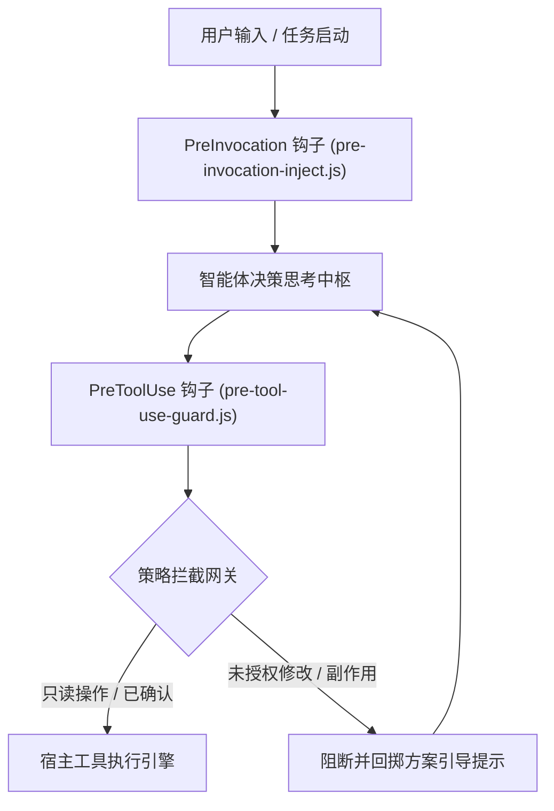

# Antigravity Plan Guard 架构设计规范

本文档详述 Google Antigravity 2.0 方案先行零信任门禁系统（`plan-guard`）的底层架构、生命周期钩子执行机制以及状态机演进模型。

---

## 1. 总体架构拓扑

Plan Guard 基于 Antigravity 插件系统的钩子架构进行轻量级无侵入切入，在智能体思考周期与工具调用周期之间构建安全护城河。



---

## 2. 核心设计原则

### 2.1 零信任原则（Zero-Trust Baseline）

任何涉及文件持久化、工作区内容变更或系统环境产生副作用的工具调用，均默认处于非受信任状态，直至捕获到明确的用户授权或方案确认标记。

### 2.2 方案先行保障（Plan-First Enforcement）

代码变更不得跳过方案对齐阶段。门禁系统在任务存在未完成清单项（如未闭环的 `todo` / 需求）时，在推理前置切面动态注入对齐指令，防止智能体在未形成完整设计前直接改写代码。

### 2.3 子智能体非受阻（Subagent Transparency）

只读调研类子智能体（如 `research`）或已被主流程显式授权的分支重构子会话，依据调用栈标记进行白名单穿透，杜绝次级智能体反复弹出确认弹窗造成交互阻塞。

---

## 3. 生命周期钩子契约

### 3.1 PreInvocation：方案状态分析与卡点注入

- <b>执行时机</b>：每一轮对话模型推理开始前。
- <b>核心职责</b>：扫描当前工作区任务卡点与对齐上下文；若存在未敲定事项，将安全提示注入系统动态上下文。

### 3.2 PreToolUse：执行前门禁拦截

- <b>执行时机</b>：模型输出工具调用意图之后，宿主实际执行之前。
- <b>核心职责</b>：解析即将被调用的工具名称与参数负载，匹配白名单规则与当前确认状态。若未达放行标准，返回拒绝指令并附带标准化操作指南。

---

## 4. 接口协议定义

### 4.1 拦截决策响应契约

门禁脚本通过标准输出（stdout）向宿主返回 JSON 格式的判定决策：

```json
{
  "verdict": "allow",
  "reason": "Read-only inspection permitted"
}
```

阻断响应格式：

```json
{
  "verdict": "deny",
  "reason": "Modification intercepted: please present the diff and call ask_question first."
}
```

---

## 5. 目录与工程结构

```
plan-guard/
├── .gitignore
├── LICENSE
├── README.md
├── README.en.md
├── plugin.json
├── hooks.example.json
├── assets/
│   └── logo.svg
├── docs/
│   ├── ARCHITECTURE.md
│   └── ARCHITECTURE.en.md
└── guard.cjs
```
